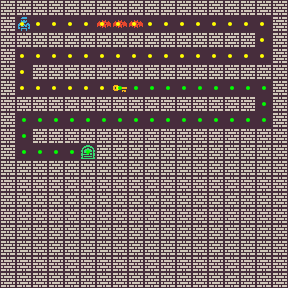
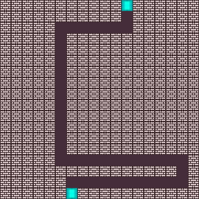
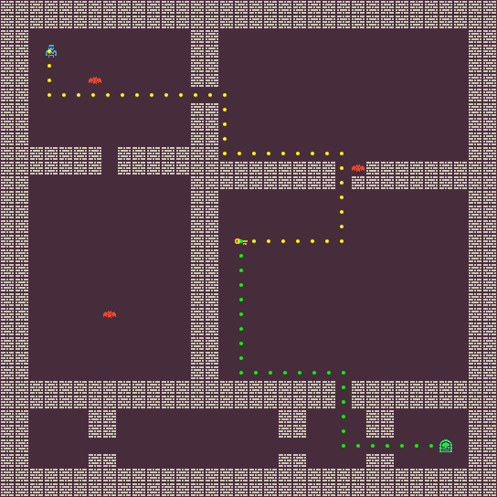
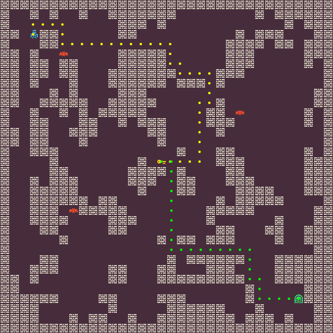
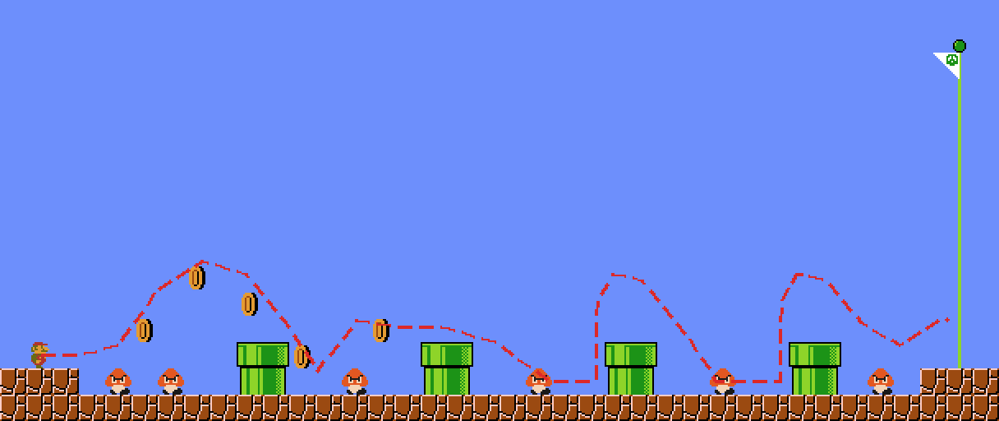
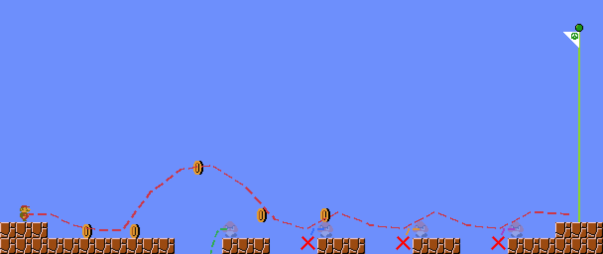
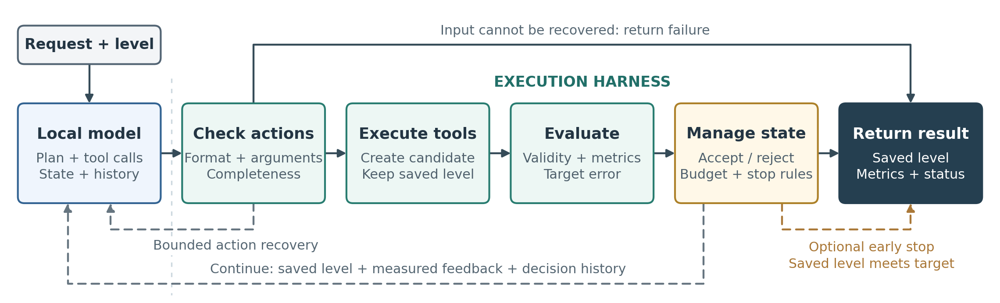
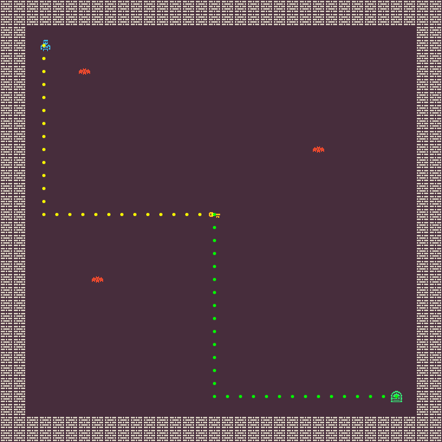
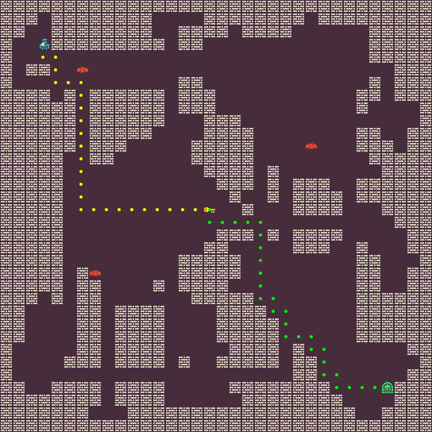
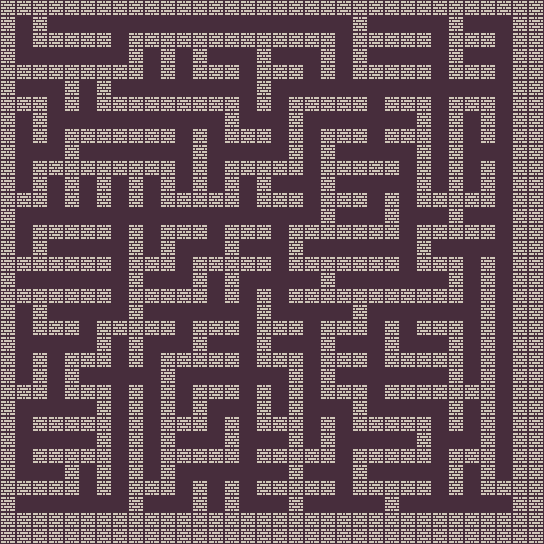

<div align="center">

# Local-Deployable-AgenticPCG

**Natural-language level design, grounded in executable tools and measured outcomes.**

Companion implementation for *Enabling Agentic PCG with Harness-Controlled Local Models*.

[](https://zehua-jiang.github.io/Local-Deployable-AgenticPCG/) [](https://ssrn.com/abstract=7502203) [](https://zehua-jiang.github.io/AgenticPCG/) [](https://github.com/JiangZehua/AgenticPCG)

[Quick start](#quick-start) · [Reproduce the paper](#reproduce-the-paper) · [Deployment](docs/deployment.md) · [Inside the harness](docs/harness.md)

</div>

<table>
<tr>
<td align="center" width="25%"><br><b>Paths with exact targets</b><br><sub>Zelda · two connected routes</sub></td>
<td align="center" width="25%"><br><b>Geometry that connects</b><br><sub>BinaryDoor · door-to-door control</sub></td>
<td align="center" width="25%"><br><b>Rooms from instructions</b><br><sub>Zelda · high-level PCG tools</sub></td>
<td align="center" width="25%"><br><b>Structures you can revise</b><br><sub>Zelda · cave generation and repair</sub></td>
</tr>
<tr>
<td colspan="2" align="center"><br><b>Control what is placed</b><br><sub>Pipes, enemies, coins and blocks—with a playability check.</sub></td>
<td colspan="2" align="center"><br><b>Control what happens during play</b><br><sub>Kills, collected coins and voluntary ground jumps.</sub></td>
</tr>
</table>

The local model proposes edits or interprets a request. The harness validates the action, executes tools, evaluates the candidate level, and decides whether to keep it. Bounded response recovery, feedback, decision history and evaluator-based stopping make this loop inspectable and reproducible.

This repository includes the base six-domain PCG framework, the paper's harness controls, fixed benchmark inputs, experiment runners and evaluators. It is self-contained: the required environment and generator code is vendored, and no original checkout or Git submodule setup is needed.

## Quick start

Use **Python 3.12** on macOS or Linux. The offline example needs neither a GPU nor model weights.

```bash
cd Local-Deployable-AgenticPCG
python3.12 -m venv .venv
source .venv/bin/activate
python -m pip install -r requirements/client-lock.txt
python -m pip install -e ".[test]"

pcg-reproduce smoke --output runs/smoke
```

Open `runs/smoke/zelda.png` and `runs/smoke/smb.png`. The example constructs and verifies a Zelda level with path lengths **17 / 31** and a Mario playthrough with **3 kills / 5 collected coins / 1 ground jump**. It uses ceiling-free certified patches and checks that every physical ground takeoff is counted. It saves the levels, rendered images and `smoke.json` locally. See [SMB builders](docs/smb-builders.md) for the corrected contract and historical comparisons.

Three larger checks also run without a model:

```bash
pcg-reproduce zelda-oracle --output runs/oracle
pcg-reproduce smb-static --output runs/static-gate
pcg-reproduce smb-dynamic --workers 4 --output runs/smb-v2
```

These regenerate the 961-target Zelda feasibility check, the 15-case static SMB playability gate, and the 210-target audited SMB construction grid. For the regression suite, run `python -m pytest -q`.

## Reproduce the paper

Start a local model server using the [deployment guide](docs/deployment.md), then run a named suite. Every suite accepts `--dry-run`, so you can inspect its exact commands, budgets and environment before launching inference.

```bash
# Inspect the paired 64-target comparison.
pcg-reproduce z64 --model qwen38 --dry-run

# Execute both open-loop and full-harness arms against the same targets.
pcg-reproduce z64 --model qwen38 --output runs/z64-qwen38

# Evaluate language understanding and high-level tool use.
pcg-reproduce natural32 --output runs/natural32
pcg-reproduce tools --output runs/tools
```

| Study | Reproduction entry point | Fixed evaluation |
| :--- | :--- | :--- |
| Paired Zelda execution | `z64`, `gemma4` | 64 targets × 2 arms per model |
| Harness components | `ladder`, `commit-stop` | Six-stage ladder; commit/stop 2 × 2 |
| Larger Zelda evaluation | `zelda-validation`, `zelda-test` | 120 validation / 721 test targets |
| Transfer to BinaryDoor | `binarydoor` | 32 targets × 2 arms |
| Natural-language control | `natural32`, `language-validation`, `language-test` | Natural-32 and fixed template splits |
| Tool access and execution loop | `tools`, `tool-loop`, `scenes` | 36 tool episodes per comparison; 12 scenes + shared null per arm; 5 arms |
| Audited Mario construction | `smb-dynamic` | 210 targets; ceiling-free patch stitching and physical takeoff audit |
| Mario gameplay operations | `smb-baseline`, `smb-pass4`, `smb-stomp`, `smb-jump`, `smb-behavior`, `smb-library` | Primitive editing, sampling and mechanic tools |
| Static Mario control | `smb-static`, `smb-static-baseline`, `smb-static-language` | Playability, primitive baseline and language contract |
| Native laptop deployment | `lmstudio` | 132 episodes through the LM Studio SDK |

The [complete experiment guide](docs/reproduction.md) specifies model revisions, settings, outputs, scoring and paired analysis. Each experiment writes its generated levels, evaluation output and command logs to the selected output directory. Historical experiment outputs and model weights are not bundled.

## Inside the loop



- **Constrain and recover actions.** Domain-aware schemas bound coordinates and tool arguments; truncated responses can receive a bounded continuation with thinking disabled.
- **Keep verified progress.** Candidate edits are evaluated before commitment. Acceptance policies, target priorities and exact stopping are explicit and independently ablatable.
- **Match the meaning of a request.** Typed language contracts distinguish map contents from simulated gameplay events. Ambiguous and unsupported requests receive explicit dispositions.

The framework retains **Binary, BinaryDoor, Zelda, Sokoban, Lode Runner and SMB**, including constructive generators, manual editing, simulation, tracing and rendering. The paper's focused experiments cover Zelda, BinaryDoor and SMB.

<details>
<summary><b>Example: revising structure while preserving a playable Zelda level</b></summary>
<br>
<table>
<tr>
<td align="center" width="33%"><br><b>Starting map</b></td>
<td align="center" width="33%"><br><b>Full execution loop</b></td>
<td align="center" width="33%"><br><b>Loop ablation</b></td>
</tr>
</table>
The full-loop example retains the player, key, door and enemies while changing the layout. The ablated example loses those entities. These are selected qualitative illustrations from the paper, not outputs of the offline smoke command.
</details>

## Make your own level

With the Qwen3.8 server running, try a single freeform episode:

```bash
RPE_PCG_COORD_GRAMMAR=on python main.py \
  --config configs/zelda_pcg_tools_32x32_all.yaml \
  --init configs/high_level_freeform_zelda_initial_32x32.txt \
  --prompt-profile freeform \
  --provider openai --model Qwen/Qwen3.8-27B \
  --base-url http://127.0.0.1:8000/v1 \
  --seed 6201 --max-steps 8 --max-tokens 4096 --temperature 0 \
  --extra-instruction "Create connected rooms while preserving the player, key, door and enemies." \
  --no-render-stats --no-render-sim --run-dir runs/my-rooms
```

Metric requests can also set executable targets in all six domains through `--request` or a JSON `--request-spec`, with `--request-dry-run` for inspection. See [metric input](docs/metric-input.md).

Inspect `final_level.txt`, `summary.json` and `trace.jsonl` in that run directory. For a new experiment, copy a configuration and change its targets or tools; keep the frozen paper manifests intact. See [harness configuration](docs/harness.md) for acceptance, feedback, recovery and protocol profiles.

## Repository map

```text
toolusepcg/   Core harness, tools, metrics, protocols and renderers
experiments/ Paper protocols, portable launchers and result evaluators
configs/     Domain configurations, frozen task manifests and ablations
benchmarks/  Fixed targets, split definitions and compact runtime templates
prompts/     Frozen geometric guidance used by the exact-control experiments
vendor/      Required PCG environments, simulators and generators
scripts/     Server launch, input materialization and native deployment utilities
tests/       Regression tests for tools, controllers and experiment runners
docs/        Reproduction, deployment, architecture and visual examples
```

Read the [benchmark input guide](benchmarks/README.md) and [third-party attribution](THIRD_PARTY.md) for the bundled data and dependencies. Legacy experiment IDs remain in internal module names to trace the original protocols; public commands use descriptive suite names. The `RPE_PCG_*` environment prefix is retained for compatibility. Prompt evolution, training pipelines, manuscript sources and historical results are outside this release.

## Citation

If you use this work, please cite the local-model harness paper and the original Agentic PCG framework:

```bibtex
@article{jiang2026enabling,
  title   = {{Enabling Agentic PCG with Harness-Controlled Local Models}},
  author  = {Jiang, Zehua and Earle, Sam and Khalifa, Ahmed and Togelius, Julian},
  journal = {Available at SSRN 7502203},
  year    = {2026},
  month   = sep,
  doi     = {10.2139/ssrn.7502203},
  url     = {https://ssrn.com/abstract=7502203},
  note    = {Available at SSRN: \url{https://ssrn.com/abstract=7502203}}
}

@article{jiang2026agentic,
  title   = {{Agentic PCG: Procedural Content Generation via Tool-using LLMs}},
  author  = {Jiang, Zehua and Earle, Sam and Khalifa, Ahmed and Togelius, Julian},
  journal = {Available at SSRN 6499021},
  year    = {2026},
  doi     = {10.2139/ssrn.6499021},
  url     = {https://ssrn.com/abstract=6499021},
  note    = {Available at SSRN: \url{https://ssrn.com/abstract=6499021}}
}
```
